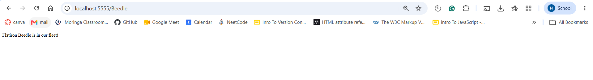

# Flatiron Cars: Flask Car Routes

A small Flask application for a fictional car company. It exposes two routes: a welcome page and a lookup that tells you whether a car model is in the company's fleet.

## Screenshot



## Features

- `GET /` returns a welcome message.
- `GET /<model>` checks the model name from the URL against the catalog and reports whether it exists.

## Routes

| Route | Example | Response |
|-------|---------|----------|
| `/` | `/` | `Welcome to Flatiron Cars` |
| `/<model>` (model exists) | `/Beedle` | `Flatiron Beedle is in our fleet!` |
| `/<model>` (model missing) | `/realCar` | `No models called realCar exists in our catalog` |

Models currently in the catalog: `Beedle`, `Crossroads`, `M2`, `Panique`. Matching is case-sensitive.

## Installation

1. Clone the repository:
   ```bash
   git clone https://github.com/<your-username>/python-flask-car-routes-lab.git
   cd python-flask-car-routes-lab
   ```
2. Install dependencies and open the virtual environment:
   ```bash
   pipenv install
   pipenv shell
   ```

## Usage

Start the development server:

```bash
python server/app.py
```

Then visit:

- http://localhost:5555/
- http://localhost:5555/Beedle
- http://localhost:5555/realCar

## Running the Tests

Run this from the project root (the folder that contains `pytest.ini`):

```bash
pytest
```

All 5 tests should pass.

## Project Structure

```
python-flask-car-routes-lab/
├── server/
│   ├── app.py            # Flask app and routes
│   └── testing/
│       └── app_test.py   # Test suite
├── pytest.ini
├── Pipfile
└── README.md
```

## Built With

- Python 3
- [Flask](https://flask.palletsprojects.com/)
- pytest

## License

This project is licensed under the Learn.co Educational Content License. See [LICENSE.md](LICENSE.md).